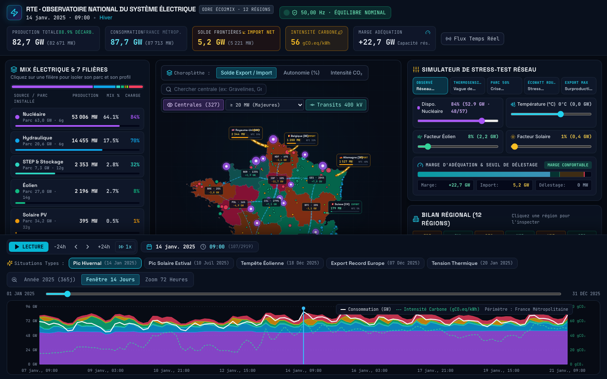
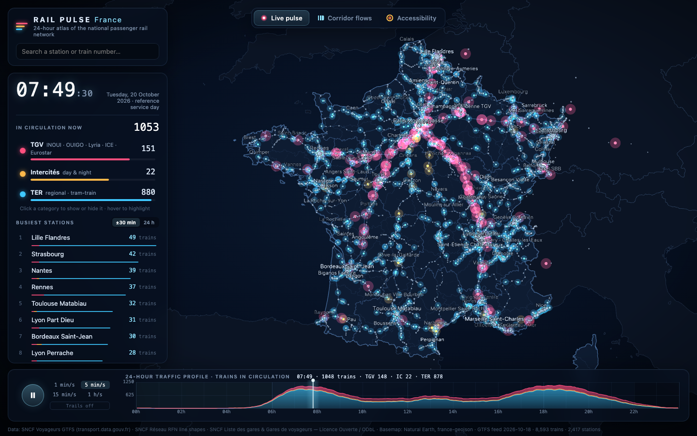
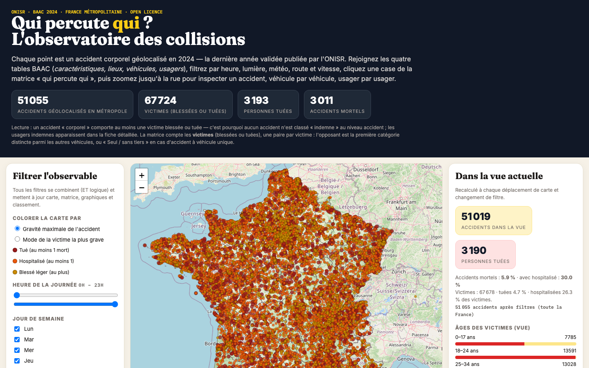
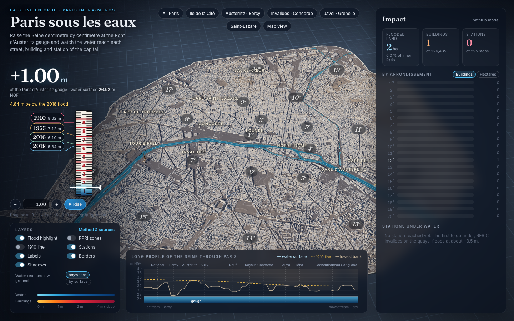

# LLM Frontier Evaluator

**A clean-room, telemetry-driven benchmark for evaluating frontier LLMs and AI agent harnesses on complex, data-heavy, end-to-end engineering builds.**

Standard coding benchmarks test isolated function completions or single-PR patches. Production engineering demands building full data pipelines and interactive applications from messy, multi-table open datasets—where agents frequently fail silently by **synthesizing fake data** or burning millions of cached tokens in retry loops.

Each run evaluates a single frozen prompt from [`prompt/`](prompt/README.md) inside a hermetic environment, auditing two complementary dimensions:
- **Process Telemetry**: Active generation vs. thinking time, output tokens, prompt-cache reuse, tool success/failure rates, and public list-price API costs.
- **Artifact Verification**: Automated Playwright UI smoke tests and anti-cheating data authenticity probes.

Inspired by Charles de Lassence's 11 October 2026 benchmark post: [Building a 3D atlas of Paris as model benchmark](https://lassence.net/posts/personal-benchmark-3d-atlas-of-paris/) / [bench.lassence.net](https://bench.lassence.net/).

### Engineering Highlights

- **Hermetic Clean-Room Isolation**: Runs execute in isolated staging workspaces (`/tmp/frontier-workspace-<run-id>/`)—headless in Docker (`Dockerfile.benchmark`) or sterile GUI profiles—enforced by `preToolUse` boundary hooks and post-run audits (`audit_isolation`) to prevent repo or grader leakage.
- **Anti-Cheating Data Probes (`probe_data.py`)**: Audits output against declarative specs in [`reference/prompt-probes.json`](reference/prompt-probes.json)—verifying record counts (up to ~394k rows), required schema markers, spatial bounding boxes, and absence of synthetic or randomized mock data.
- **Automated Runtime Smoke Tests (`verify_run.py`)**: Boots applications locally, drives headless Chromium via Playwright, asserts HTTP 200 with zero page errors, validates DOM/Canvas/WebGL rendering contexts, and captures deterministic `1440×900` screenshots.
- **Zero-Estimation Telemetry Engine (`tool_events.py`, `run_common.py`)**: Measures generation time by subtracting parallel tool intervals (`wall_clock_minus_tool_time`), deduplicates thinking blocks (`afterAgentThought`), reconciles telemetry against billing CSVs, and computes list-price API costs across context variants and tiers.

## Comparisons

Rows compare only inside one series, so each series has its own table ([`docs/protocol.md`](docs/protocol.md)). Metric details and tool classifications are documented in [`docs/metrics.md`](docs/metrics.md) and [`docs/tool-buckets.md`](docs/tool-buckets.md); pricing rates use [`reference/pricing-2026-10-18.json`](reference/pricing-2026-10-18.json).

### `france-electricity-carbon-flow`



**Local series `france-electricity-carbon-flow-cursor`**: Cursor, recorded with this repository ([`runs/`](runs/README.md)).

| Model | Harness | Output tokens (k) | Model time (min, tools excluded) | Tool calls (✓ / ✗) | Context re-read (M cached tokens) | Est. cost (USD) | Verification |
| --- | --- | --- | --- | --- | --- | --- | --- |
| Gemini 4 Argon 1m medium | Cursor | 73k | 17.7 min<br>14.6 min thinking | 21 ✓<br>7 ✗ | 1.0M | $2.55 | UI ✓<br>Data 4/4 ✓<br>3.5k records<br>[Live Demo](demos/france-electricity-carbon-flow/2026-10-19-cursor-gemini-4-argon-1m-medium/index.html) |

### `france-rail-24h-pulse`



**Local series `france-rail-24h-pulse-cursor`**: Cursor, recorded with this repository ([`runs/`](runs/README.md)).

| Model | Harness | Output tokens (k) | Model time (min, tools excluded) | Tool calls (✓ / ✗) | Context re-read (M cached tokens) | Est. cost (USD) | Verification |
| --- | --- | --- | --- | --- | --- | --- | --- |
| Claude Opus 5.5 300k high | Cursor | 90k | 20.1 min<br>7.7 min thinking | 40 ✓<br>10 ✗ | 5.5M | $6.53 | UI ✓<br>Data 3/3 ✓<br>820k records<br>[Live Demo](demos/france-rail-24h-pulse/2026-10-19-cursor-claude-opus-5-5-high-300k-high/index.html) |
| Gemini 3.8 Flash high | Cursor | 118k | 18.1 min<br>5.8 min thinking | 122 ✓<br>8 ✗ | 11.0M | $4.75 | UI ✗<br>Data 3/3 ✓<br>828k records<br>[Live Demo](demos/france-rail-24h-pulse/2026-10-22-cursor-gemini-3-8-flash-high/index.html) |
| GLM 5.3 high | Cursor | 59k | 10.4 min<br>3.9 min thinking | 78 ✓<br>5 ✗ | 5.0M | $2.95 | UI ✗<br>Data 3/3 ✓<br>827k records<br>[Live Demo](demos/france-rail-24h-pulse/2026-10-22-cursor-glm-5-3-high/index.html) |
| GPT-5.6 Sol medium | Cursor | 15k | 2.8 min<br>0.2 min thinking | 13 ✓<br>0 ✗ | 0.2M | $0.60 | UI ✗<br>Data 0/3 ⚠<br>118 records<br>[Live Demo](demos/france-rail-24h-pulse/2026-10-22-cursor-gpt-5-6-sol-medium/index.html) |
| Grok 4.7 high | Cursor | n/a | 60.1 min<br>49.8 min thinking | 138 ✓<br>4 ✗ | n/a | n/a | UI ✗<br>Data 3/3 ✓<br>888k records<br>[Live Demo](demos/france-rail-24h-pulse/2026-10-22-cursor-grok-4-7-high/index.html) |
| Muse Wonder medium | Cursor | 25k | 3.4 min | 18 ✓<br>1 ✗ | 0.6M | $0.93 | UI ✓<br>Data 0/3 ⚠<br>0 records<br>[Live Demo](demos/france-rail-24h-pulse/2026-10-22-cursor-muse-wonder-medium/index.html) |

*Note: Token and cost columns show `n/a` for headless CLI runs until a Cursor billing CSV export is ingested (`finish_run.py --usage-export`).*

**Local series `france-rail-24h-pulse-claude-code`**: Claude Code, recorded with this repository ([`runs/`](runs/README.md)).

| Model | Harness | Output tokens (k) | Model time (min, tools excluded) | Tool calls (✓ / ✗) | Context re-read (M cached tokens) | Est. cost (USD) | Verification |
| --- | --- | --- | --- | --- | --- | --- | --- |
| Claude Sonnet 5.5 high | Claude Code | 231k | 26.9 min<br>16.6 min thinking | 97 ✓<br>2 ✗ | 17.9M | $4.93 | UI ✓<br>Data 3/3 ✓<br>830k records<br>[Live Demo](demos/france-rail-24h-pulse/2026-10-25-claude-code-claude-sonnet-5-5-high/index.html) |

### `france-road-accidents`



**Local series `france-road-accidents-cursor`**: Cursor, recorded with this repository ([`runs/`](runs/README.md)).

| Model | Harness | Output tokens (k) | Model time (min, tools excluded) | Tool calls (✓ / ✗) | Context re-read (M cached tokens) | Est. cost (USD) | Verification |
| --- | --- | --- | --- | --- | --- | --- | --- |
| Muse Wonder 300k medium | Cursor | 25k | 4.8 min | 34 ✓<br>7 ✗ | 1.7M | $1.76 | UI ✓<br>Data 2/2 ✓<br>394k records<br>[Live Demo](demos/france-road-accidents/2026-10-19-cursor-muse-wonder-300k-medium/index.html) |

**Local series `france-road-accidents-claude-code`**: Claude Code, recorded with this repository ([`runs/`](runs/README.md)).

| Model | Harness | Output tokens (k) | Model time (min, tools excluded) | Tool calls (✓ / ✗) | Context re-read (M cached tokens) | Est. cost (USD) | Verification |
| --- | --- | --- | --- | --- | --- | --- | --- |
| Claude Opus 5.5 medium | Claude Code | 91k | 14.1 min<br>6.3 min thinking | 43 ✓<br>2 ✗ | 4.4M | $3.41 | UI ✓<br>Data 2/2 ✓<br>1.2M records<br>[Live Demo](demos/france-road-accidents/2026-10-26-claude-code-claude-opus-5-5-medium/index.html) |
| Claude Sonnet 5.5 high | Claude Code | 321k | 37.4 min<br>22.7 min thinking | 142 ✓<br>10 ✗ | 38.9M | $8.25 | UI ✓<br>Data 2/2 ✓<br>1.1M records<br>[Live Demo](demos/france-road-accidents/2026-10-26-claude-code-claude-sonnet-5-5-high/index.html) |

### `paris-1910-flood-simulator`



**Local series `paris-1910-flood-simulator-cursor`**: Cursor, recorded with this repository ([`runs/`](runs/README.md)).

| Model | Harness | Output tokens (k) | Model time (min, tools excluded) | Tool calls (✓ / ✗) | Context re-read (M cached tokens) | Est. cost (USD) | Verification |
| --- | --- | --- | --- | --- | --- | --- | --- |
| Claude Opus 5.5 high | Cursor | 228k | 42.2 min<br>19.6 min thinking | 134 ✓<br>11 ✗ | 12.9M | $12.08 | UI ✓<br>Data 6/6 ✓<br>351k records<br>[Live Demo](demos/paris-1910-flood-simulator/2026-10-20-cursor-claude-opus-5-5-high/index.html) |
| Claude Opus 5.5 medium | Cursor | 198k | 39.2 min<br>15.4 min thinking | 171 ✓<br>2 ✗ | 16.0M | $13.81 | UI ✓<br>Data 6/6 ✓<br>142k records<br>[Live Demo](demos/paris-1910-flood-simulator/2026-10-21-cursor-claude-opus-5-5-medium/index.html) |
| Gemini 4 Argon medium | Cursor | 133k | 32.4 min<br>17.4 min thinking | 91 ✓<br>10 ✗ | 6.0M | $4.29 | UI ✓<br>Data 6/6 ✓<br>9.5k records<br>[Live Demo](demos/paris-1910-flood-simulator/2026-10-22-cursor-gemini-4-argon-medium/index.html) |

**Local series `paris-1910-flood-simulator-claude-code`**: Claude Code, recorded with this repository ([`runs/`](runs/README.md)).

| Model | Harness | Output tokens (k) | Model time (min, tools excluded) | Tool calls (✓ / ✗) | Context re-read (M cached tokens) | Est. cost (USD) | Verification |
| --- | --- | --- | --- | --- | --- | --- | --- |
| Claude Sonnet 5.5 high | Claude Code | 358k | 43.1 min<br>29.1 min thinking | 168 ✓<br>11 ✗ | 32.2M | $8.06 | UI ✓<br>Data 6/6 ✓<br>146k records<br>[Live Demo](demos/paris-1910-flood-simulator/2026-10-26-claude-code-claude-sonnet-5-5-high-2/index.html) |

### `paris-tree-canopy`


**Local series `paris-tree-canopy-cursor`**: Cursor, recorded with this repository ([`runs/`](runs/README.md)).

| Model | Harness | Output tokens (k) | Model time (min, tools excluded) | Tool calls (✓ / ✗) | Context re-read (M cached tokens) | Est. cost (USD) | Verification |
| --- | --- | --- | --- | --- | --- | --- | --- |
| Claude Haiku 5.5 high | Cursor | 79k | 6.4 min | 94 ✓<br>1 ✗ | 7.5M | $2.06 | UI ✗<br>Data 3/3 ✓<br>177k records<br>[Live Demo](demos/paris-tree-canopy/2026-10-24-cursor-claude-haiku-5-5-high/index.html) |
| Claude Sonnet 5.5 high | Cursor | n/a | 23.2 min<br>10.3 min thinking | 72 ✓<br>3 ✗ | n/a | n/a | UI ✗<br>Data 3/3 ✓<br>254k records<br>[Live Demo](demos/paris-tree-canopy/2026-10-24-cursor-claude-sonnet-5-5-high/index.html) |
| Composer 2.5 high | Cursor | 26k | 2.2 min<br>0.4 min thinking | 58 ✓<br>3 ✗ | 0.6M | $0.21 | UI ✗<br>Data 3/3 ✓<br>220k records<br>[Live Demo](demos/paris-tree-canopy/2026-10-24-cursor-composer-2-5-high/index.html) |
| Gemini 3.8 Flash high | Cursor | 98k | 14.1 min<br>8.0 min thinking | 78 ✓<br>9 ✗ | 5.5M | $2.56 | UI ✗<br>Data 3/3 ✓<br>441k records<br>[Live Demo](demos/paris-tree-canopy/2026-10-24-cursor-gemini-3-8-flash-high/index.html) |
| GPT-5.6 Luna high | Cursor | 19k | 2.7 min<br>0.3 min thinking | 14 ✓<br>0 ✗ | 0.2M | $0.10 | UI ✓<br>Data 0/3 ⚠<br>0 records<br>[Live Demo](demos/paris-tree-canopy/2026-10-24-cursor-gpt-5-6-luna-high/index.html) |

*Note: Token and cost columns show `n/a` for headless CLI runs until a Cursor billing CSV export is ingested (`finish_run.py --usage-export`).*

**Local series `paris-tree-canopy-claude-code`**: Claude Code, recorded with this repository ([`runs/`](runs/README.md)).

| Model | Harness | Output tokens (k) | Model time (min, tools excluded) | Tool calls (✓ / ✗) | Context re-read (M cached tokens) | Est. cost (USD) | Verification |
| --- | --- | --- | --- | --- | --- | --- | --- |
| Claude Opus 5.5 medium | Claude Code | 105k | 16.2 min<br>6.1 min thinking | 72 ✓<br>6 ✗ | 7.9M | $4.59 | UI ✓<br>Data 2/3 ✓<br>34k records<br>[Live Demo](demos/paris-tree-canopy/2026-10-26-claude-code-claude-opus-5-5-medium/index.html) |
| Claude Sonnet 5.5 high | Claude Code | 195k | 22.1 min<br>12.3 min thinking | 81 ✓<br>2 ✗ | 11.7M | $3.84 | UI ✓<br>Data 2/3 ✓<br>8.0k records<br>[Live Demo](demos/paris-tree-canopy/2026-10-26-claude-code-claude-sonnet-5-5-high/index.html) |

## Protocol

Each benchmark run evaluates one model and agent harness against a single frozen prompt under controlled conditions ([`docs/protocol.md`](docs/protocol.md)):

- **Single-prompt, zero-intervention execution**: Sends the exact byte sequence of `prompt/<prompt-id>.txt` (verified by SHA-256) as a single user prompt with no operator intervention, hints, or mid-run edits.
- **Clean-room isolation**: Runs in `/tmp/frontier-workspace-<run-id>/` (Docker container or sterile GUI profile) with an independent git boundary, isolating parent repo files, grading probes, sibling runs, and global skills ([`docs/design-run-isolation.md`](docs/design-run-isolation.md)).
- **Token & cost accounting**: Extracts token output and prompt-cache reads directly from harness telemetry and usage exports without heuristic estimation ([`docs/metrics.md`](docs/metrics.md)). Estimated cost reflects public list prices from [`reference/pricing-2026-10-18.json`](reference/pricing-2026-10-18.json).
- **Model time & tool telemetry**: Classifies tool calls (`✓` / `✗`) into standard buckets ([`docs/tool-buckets.md`](docs/tool-buckets.md)), separates model generation time from tool runtime, and verifies outputs via Playwright (`verify_run.py`) and data probes (`probe_data.py`).

## Prompts

1. [`france-road-accidents`](prompt/france-road-accidents.txt): build, from the four relational ONISR BAAC open-data tables, an interactive map and "who hits whom" collision observatory of corporeal road accidents in metropolitan France across severity, transport modes, and road conditions ([runs](runs/france-road-accidents/)).
2. [`france-socio-electoral-atlas`](prompt/france-socio-electoral-atlas.txt): build, from INSEE Filosofi, demographic, and Ministry of the Interior open data, an interactive bivariate socio-electoral atlas of metropolitan France across ~35,000 communes with a linked brushable scatterplot.
3. [`adaptive-endurance-coach`](prompt/adaptive-endurance-coach.txt): build an adaptive training planner and physiological simulator for triathlon, running, cycling, and cross-training that derives individualized power/pace/HR/swim zones, models Banister CTL/ATL/TSB load dynamics, exports `.ics`/`.zwo` workouts, and live-recalibrates the plan when sessions are skipped or altered.
4. [`paris-1910-flood-simulator`](prompt/paris-1910-flood-simulator.txt): build, from Apur, Paris, and Île-de-France Mobilités open data, an interactive 3D simulator of the Seine rising up to and beyond the 1910 centennial flood (+8.62 m at Austerlitz), submerging buildings, streets, and rail stations against PPRI flood risk zones ([runs](runs/paris-1910-flood-simulator/)).
5. [`france-rail-24h-pulse`](prompt/france-rail-24h-pulse.txt): build, from SNCF GTFS and Réseau Ferré National open data, an interactive 24-hour animated map and station-to-station travel-time accessibility atlas of the French passenger rail network (TGV, Intercités, TER) ([runs](runs/france-rail-24h-pulse/)).
6. [`france-electricity-carbon-flow`](prompt/france-electricity-carbon-flow.txt): build, from RTE éCO2mix and ODRE open data, an interactive observatory and grid stress-test simulator of the French electricity system mapping regional generation, power plants, cross-border flows, and carbon intensity ([runs](runs/france-electricity-carbon-flow/)).
7. [`paris-tree-canopy`](prompt/paris-tree-canopy.txt): build, from Paris Open Data municipal tree inventory and district boundaries, an interactive urban forestry map and biodiversity explorer tracking species distribution, tree dimensions, remarkable heritage specimens, and canopy density across arrondissements.
8. [`velib-realtime-flow`](prompt/velib-realtime-flow.txt): build, from Paris Open Data and GBFS real-time feeds, an interactive bike-share observatory and station availability explorer for the Greater Paris Vélib' Métropole network tracking live mechanical and electric bike stock, dock availability, and territorial flow.

## Launch your own run

### Prerequisites

```bash
uv sync --all-extras
uv run playwright install chromium
```

### Option A: Headless in Docker (Recommended)

Automated, reproducible evaluation runs inside an isolated Linux container with preflight checks and unattended verification.

1. **Configure harness API key**:
   ```bash
   export CURSOR_API_KEY="your-key"          # Cursor harness
   export CLAUDE_CODE_OAUTH_TOKEN="token"    # Claude Code harness, subscription billing (from `claude setup-token`); preferred
   # or: export ANTHROPIC_API_KEY="your-key" # Claude Code harness, per-token API billing (ignored when the token is set)
   ```
   *Tip*: Store keys in a local, git-ignored `.env` file (`CURSOR_API_KEY="..."`), a custom key file (`CURSOR_API_KEY_FILE=...`), or pass `--env-file <path>`.

2. **Execute one-shot benchmark**:
   ```bash
   python3 scripts/run_benchmark.py --prompt paris-1910-flood-simulator --harness cursor --model "Claude Opus 5.5" --reasoning high --timeout 3600
   # Claude Code harness (subscription token or API key from step 1):
   python3 scripts/run_benchmark.py --prompt paris-1910-flood-simulator --harness claude-code --model "Claude Sonnet 5.5" --reasoning high --timeout 3600
   ```
   `--timeout` is the per-run container limit in seconds (default and recommended `3600`, i.e. 60 minutes); a run that hits it is stopped and recorded as incomplete.
   The runner automatically:
   - Verifies preflight requirements (Docker daemon, image tag, credentials).
   - Builds runner image `llm-frontier-evaluator-runner:latest` from `Dockerfile.benchmark` if missing.
   - Scaffolds run directory under `runs/` and isolated workspace at `/tmp/frontier-workspace-<run-id>/`.
   - Executes the agent inside the container without global skills, plugins, or repo leakage.
   - Auto-triggers `finish_run.py --verify --skip-usage-copy --non-interactive` to collect artifacts, run Playwright/data probes, and write `run.json`.

   *(Optional manual image build)*:
   ```bash
   docker build --platform linux/amd64 -f Dockerfile.benchmark -t llm-frontier-evaluator-runner:latest .
   ```
   *(Uses `--platform linux/amd64` for x86_64 `cursor-agent` binary compatibility across Apple Silicon and Linux hosts.)*

   *Note on context windows*: Headless CLI runs omit `--context` because CLI harnesses do not configure context window sizes. If executing against a pre-scaffolded directory with a set context, pass `--allow-cli-context-override` only to override context to `null`.

3. **Optional: Ingest billing usage export**:
   Ingest a CSV export from the Cursor dashboard (`~/.cursor/usage-exports/<run-id>.csv`) into the completed run:
   ```bash
   python3 scripts/finish_run.py --prompt paris-1910-flood-simulator --run-id <run-id> --usage-export ~/.cursor/usage-exports/<run-id>.csv --non-interactive
   ```

### Option B: Clean-Room GUI

Use the native Cursor GUI or test specific context window variants (e.g. `--context 500k`, `--context 1m`):

1. **Scaffold run directory**:
   ```bash
   python3 scripts/setup_run.py --prompt paris-1910-flood-simulator --harness cursor --model "Claude Opus 5.5" --reasoning high --context 500k
   ```

2. **Launch isolated GUI session**:
   ```bash
   /tmp/frontier-workspace-<run-id>-launch.sh
   ```
   Sets up a sterile profile, blocks external paths via `preToolUse` boundary hooks, and copies prompt bytes to clipboard (`pbcopy`). Paste the prompt as the single user message and let the agent run.

3. **Verify and finish**:
   ```bash
   python3 scripts/finish_run.py --prompt paris-1910-flood-simulator --run-id <run-id> --verify
   ```

### Interactive Visual Benchmark Explorer

To generate or launch the interactive static dashboard and Pareto frontier gallery:

```bash
# Build the dashboard data payload and static bundle
uv run python3 scripts/build_dashboard.py

# Verify the dashboard is synchronized with repository run records
uv run python3 scripts/build_dashboard.py --check

# Serve locally
uv run python3 scripts/build_dashboard.py --serve 8000
```

### Synchronize comparison tables

After completing or updating runs, synchronize the comparison tables in `README.md`:

```bash
python3 scripts/compare_runs.py --sync-readme
python3 scripts/compare_runs.py --check-readme
```

For detailed protocol guidelines, metrics definitions, container isolation specifications, and repository architecture, see [`docs/protocol.md`](docs/protocol.md), [`docs/metrics.md`](docs/metrics.md), [`docs/design-run-isolation.md`](docs/design-run-isolation.md), and [`docs/architecture.md`](docs/architecture.md).
