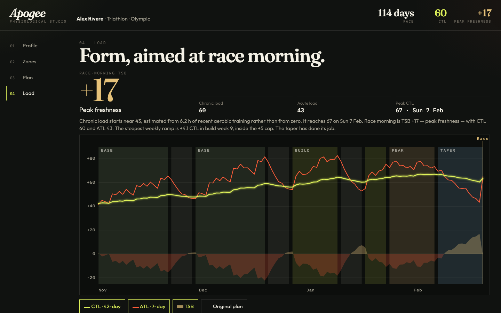
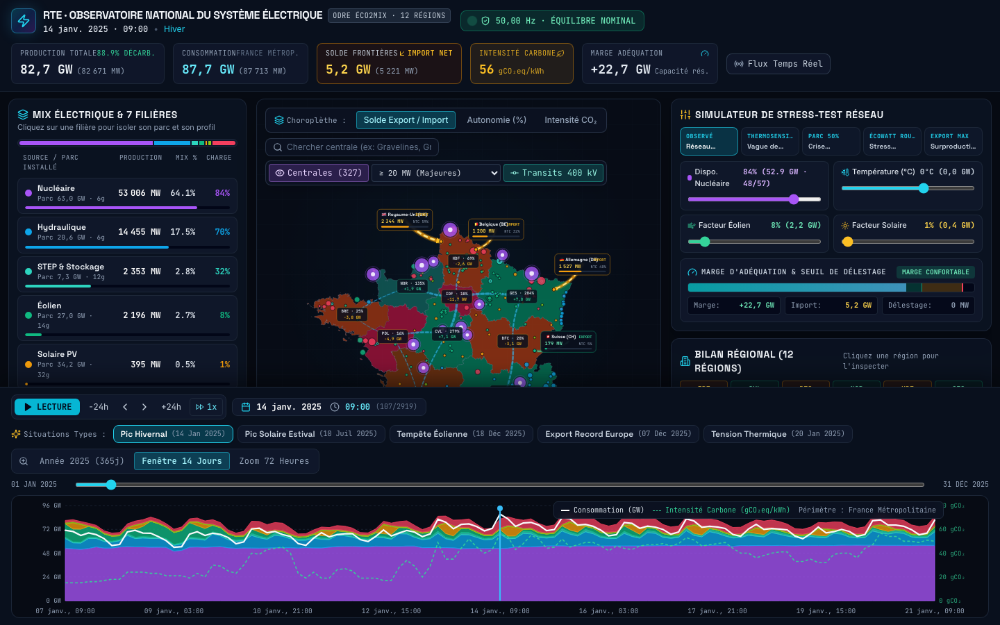
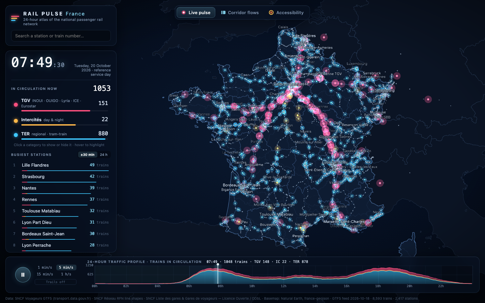
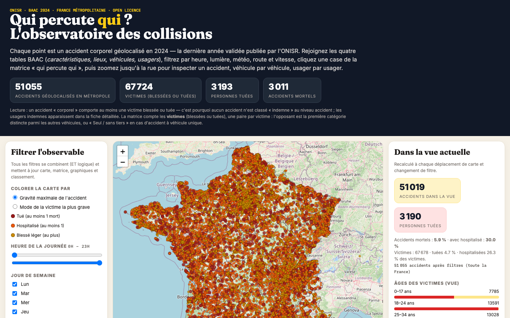
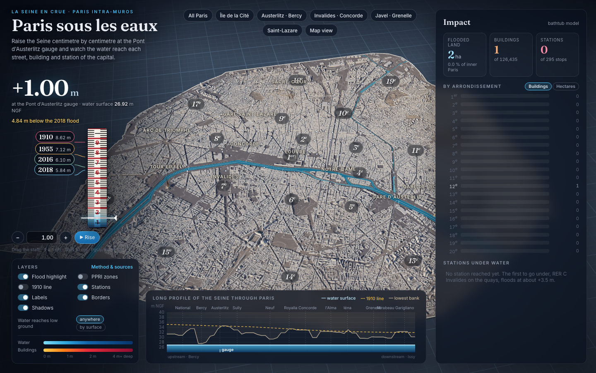

# Benchmark Results

Full per-series comparison tables, screenshots, and hosted live demo links for the LLM Frontier Evaluator benchmark runs across all evaluated prompts and agent harnesses.

- **Interactive Web Dashboard & Pareto Frontier Explorer**: [loic-brissot.github.io/llm-frontier-evaluator](https://loic-brissot.github.io/llm-frontier-evaluator/)
- **Hosted Live Demos Showcase**: [loic-brissot.github.io/llm-frontier-evaluator-demos](https://loic-brissot.github.io/llm-frontier-evaluator-demos/)
- **Benchmark Tool & Methodology Overview**: [`README.md`](README.md)
- **Evaluation Protocol**: [`docs/protocol.md`](docs/protocol.md)
- **Metrics & Tool Buckets**: [`docs/metrics.md`](docs/metrics.md) | [`docs/tool-buckets.md`](docs/tool-buckets.md)

## Comparisons

Rows compare only inside one series, so each series has its own table ([`docs/protocol.md`](docs/protocol.md)). Metric details and tool classifications are documented in [`docs/metrics.md`](docs/metrics.md) and [`docs/tool-buckets.md`](docs/tool-buckets.md); pricing rates use [`reference/pricing-2026-10-18.json`](reference/pricing-2026-10-18.json).

### `adaptive-endurance-coach`

**Local series `adaptive-endurance-coach-cursor`**: Cursor, recorded with this repository ([`runs/`](runs/README.md)).

| Model | Harness | Output tokens (k) | Model time (min, tools excluded) | Tool calls (✓ / ✗) | Context re-read (M cached tokens) | Est. cost (USD) | Verification |
| --- | --- | --- | --- | --- | --- | --- | --- |
| Grok 4.7 high | Cursor | 247k | n/a | 154 ✓ 1 ✗ | 8.0M | $6.19 | UI ✓ Data 5/5 ✓ 1 records [Live Demo](https://loic-brissot.github.io/llm-frontier-evaluator-demos/demos/adaptive-endurance-coach/2026-10-28-cursor-grok-4-7-high/index.html) |
| claude-haiku-5-5 high | Cursor | 83k | 6.5 min | 67 ✓ 0 ✗ | 4.6M | $1.31 | UI ✓ Data 5/5 ✓ 0 records [Live Demo](https://loic-brissot.github.io/llm-frontier-evaluator-demos/demos/adaptive-endurance-coach/2026-10-30-cursor-claude-haiku-5-5-high/index.html) |
| composer-2.5 high | Cursor | 29k | 2.3 min 0.1 min thinking | 63 ✓ 3 ✗ | 0.9M | $0.26 | UI ✗ Data 4/5 ✓ 177 records [Live Demo](https://loic-brissot.github.io/llm-frontier-evaluator-demos/demos/adaptive-endurance-coach/2026-10-30-cursor-composer-2-5-high/index.html) |
| kimi-k3 high | Cursor | 69k | 5.2 min 2.4 min thinking | 28 ✓ 3 ✗ | 1.8M | $2.24 | UI ✓ Data 5/5 ✓ 0 records [Live Demo](https://loic-brissot.github.io/llm-frontier-evaluator-demos/demos/adaptive-endurance-coach/2026-10-30-cursor-kimi-k3-high/index.html) |
| muse-wonder high | Cursor | 21k | 2.2 min | 8 ✓ 0 ✗ | 0.2M | $0.63 | UI ✓ Data 5/5 ✓ 0 records [Live Demo](https://loic-brissot.github.io/llm-frontier-evaluator-demos/demos/adaptive-endurance-coach/2026-10-30-cursor-muse-wonder-high/index.html) |
| gemini-3.8-flash high | Cursor | 109k | 13.7 min 8.9 min thinking | 59 ✓ 3 ✗ | 4.5M | $2.28 | UI ✓ Data 5/5 ✓ 221 records [Live Demo](https://loic-brissot.github.io/llm-frontier-evaluator-demos/demos/adaptive-endurance-coach/2026-10-31-cursor-gemini-3-8-flash-high/index.html) |

### `france-electricity-carbon-flow`

**Local series `france-electricity-carbon-flow-cursor`**: Cursor, recorded with this repository ([`runs/`](runs/README.md)).

| Model | Harness | Output tokens (k) | Model time (min, tools excluded) | Tool calls (✓ / ✗) | Context re-read (M cached tokens) | Est. cost (USD) | Verification |
| --- | --- | --- | --- | --- | --- | --- | --- |
| Gemini 4 Argon 1m medium | Cursor | 73k | 17.7 min 14.6 min thinking | 23 ✓ 5 ✗ | 1.0M | $2.55 | UI ✓ Data 4/4 ✓ 3.5k records [Live Demo](https://loic-brissot.github.io/llm-frontier-evaluator-demos/demos/france-electricity-carbon-flow/2026-10-19-cursor-gemini-4-argon-1m-medium/index.html) |

### `france-rail-24h-pulse`

**Local series `france-rail-24h-pulse-cursor`**: Cursor, recorded with this repository ([`runs/`](runs/README.md)).

| Model | Harness | Output tokens (k) | Model time (min, tools excluded) | Tool calls (✓ / ✗) | Context re-read (M cached tokens) | Est. cost (USD) | Verification |
| --- | --- | --- | --- | --- | --- | --- | --- |
| Claude Opus 5.5 300k high | Cursor | 90k | 20.1 min 7.7 min thinking | 47 ✓ 3 ✗ | 5.5M | $6.53 | UI ✓ Data 3/3 ✓ 820k records [Live Demo](https://loic-brissot.github.io/llm-frontier-evaluator-demos/demos/france-rail-24h-pulse/2026-10-19-cursor-claude-opus-5-5-high-300k-high/index.html) |
| Gemini 3.8 Flash high | Cursor | 119k | 18.1 min 5.8 min thinking | 122 ✓ 8 ✗ | 11.0M | $4.76 | UI ✗ Data 3/3 ✓ 828k records [Live Demo](https://loic-brissot.github.io/llm-frontier-evaluator-demos/demos/france-rail-24h-pulse/2026-10-22-cursor-gemini-3-8-flash-high/index.html) |
| GLM 5.3 high | Cursor | 79k | 10.4 min 3.9 min thinking | 78 ✓ 2 ✗ | 5.1M | $3.16 | UI ✗ Data 3/3 ✓ 827k records [Live Demo](https://loic-brissot.github.io/llm-frontier-evaluator-demos/demos/france-rail-24h-pulse/2026-10-22-cursor-glm-5-3-high/index.html) |
| GPT-5.6 Sol medium | Cursor | 15k | 2.8 min 0.2 min thinking | 13 ✓ 0 ✗ | 0.2M | $0.63 | UI ✗ Data 0/3 ⚠ 118 records [Live Demo](https://loic-brissot.github.io/llm-frontier-evaluator-demos/demos/france-rail-24h-pulse/2026-10-22-cursor-gpt-5-6-sol-medium/index.html) |
| Grok 4.7 high | Cursor | 213k | 60.1 min 49.8 min thinking | 138 ✓ 4 ✗ | 9.8M | $7.11 | UI ✗ Data 3/3 ✓ 888k records [Live Demo](https://loic-brissot.github.io/llm-frontier-evaluator-demos/demos/france-rail-24h-pulse/2026-10-22-cursor-grok-4-7-high/index.html) |
| Muse Wonder medium | Cursor | 26k | 3.4 min | 18 ✓ 1 ✗ | 0.6M | $0.98 | UI ✓ Data 0/3 ⚠ 0 records [Live Demo](https://loic-brissot.github.io/llm-frontier-evaluator-demos/demos/france-rail-24h-pulse/2026-10-22-cursor-muse-wonder-medium/index.html) |

**Local series `france-rail-24h-pulse-claude-code`**: Claude Code, recorded with this repository ([`runs/`](runs/README.md)).

| Model | Harness | Output tokens (k) | Model time (min, tools excluded) | Tool calls (✓ / ✗) | Context re-read (M cached tokens) | Est. cost (USD) | Verification |
| --- | --- | --- | --- | --- | --- | --- | --- |
| Claude Sonnet 5.5 high | Claude Code | 231k | 26.9 min 16.6 min thinking | 98 ✓ 1 ✗ | 17.9M | $5.42 | UI ✓ Data 3/3 ✓ 830k records [Live Demo](https://loic-brissot.github.io/llm-frontier-evaluator-demos/demos/france-rail-24h-pulse/2026-10-25-claude-code-claude-sonnet-5-5-high/index.html) |

### `france-road-accidents`

**Local series `france-road-accidents-cursor`**: Cursor, recorded with this repository ([`runs/`](runs/README.md)).

| Model | Harness | Output tokens (k) | Model time (min, tools excluded) | Tool calls (✓ / ✗) | Context re-read (M cached tokens) | Est. cost (USD) | Verification |
| --- | --- | --- | --- | --- | --- | --- | --- |
| Muse Wonder 300k medium | Cursor | 26k | 4.8 min | 37 ✓ 4 ✗ | 1.7M | $1.81 | UI ✓ Data 2/2 ✓ 394k records [Live Demo](https://loic-brissot.github.io/llm-frontier-evaluator-demos/demos/france-road-accidents/2026-10-19-cursor-muse-wonder-300k-medium/index.html) |

**Local series `france-road-accidents-claude-code`**: Claude Code, recorded with this repository ([`runs/`](runs/README.md)).

| Model | Harness | Output tokens (k) | Model time (min, tools excluded) | Tool calls (✓ / ✗) | Context re-read (M cached tokens) | Est. cost (USD) | Verification |
| --- | --- | --- | --- | --- | --- | --- | --- |
| Claude Opus 5.5 medium | Claude Code | 91k | 14.1 min 6.3 min thinking | 44 ✓ 2 ✗ | 4.4M | $3.84 | UI ✓ Data 2/2 ✓ 1.2M records [Live Demo](https://loic-brissot.github.io/llm-frontier-evaluator-demos/demos/france-road-accidents/2026-10-26-claude-code-claude-opus-5-5-medium/index.html) |
| Claude Sonnet 5.5 high | Claude Code | 321k | 37.4 min 22.7 min thinking | 143 ✓ 6 ✗ | 38.9M | $8.93 | UI ✓ Data 2/2 ✓ 1.1M records [Live Demo](https://loic-brissot.github.io/llm-frontier-evaluator-demos/demos/france-road-accidents/2026-10-26-claude-code-claude-sonnet-5-5-high/index.html) |

### `paris-1910-flood-simulator`

**Local series `paris-1910-flood-simulator-cursor`**: Cursor, recorded with this repository ([`runs/`](runs/README.md)).

| Model | Harness | Output tokens (k) | Model time (min, tools excluded) | Tool calls (✓ / ✗) | Context re-read (M cached tokens) | Est. cost (USD) | Verification |
| --- | --- | --- | --- | --- | --- | --- | --- |
| Claude Opus 5.5 high | Cursor | 228k | 42.2 min 19.6 min thinking | 134 ✓ 8 ✗ | 12.9M | $12.08 | UI ✓ Data 6/6 ✓ 351k records [Live Demo](https://loic-brissot.github.io/llm-frontier-evaluator-demos/demos/paris-1910-flood-simulator/2026-10-20-cursor-claude-opus-5-5-high/index.html) |
| Claude Opus 5.5 medium | Cursor | 198k | 39.2 min 15.4 min thinking | 171 ✓ 1 ✗ | 16.0M | $13.81 | UI ✓ Data 6/6 ✓ 142k records [Live Demo](https://loic-brissot.github.io/llm-frontier-evaluator-demos/demos/paris-1910-flood-simulator/2026-10-21-cursor-claude-opus-5-5-medium/index.html) |
| Gemini 4 Argon medium | Cursor | 133k | 32.4 min 17.4 min thinking | 91 ✓ 9 ✗ | 6.0M | $4.29 | UI ✓ Data 6/6 ✓ 9.5k records [Live Demo](https://loic-brissot.github.io/llm-frontier-evaluator-demos/demos/paris-1910-flood-simulator/2026-10-22-cursor-gemini-4-argon-medium/index.html) |

**Local series `paris-1910-flood-simulator-claude-code`**: Claude Code, recorded with this repository ([`runs/`](runs/README.md)).

| Model | Harness | Output tokens (k) | Model time (min, tools excluded) | Tool calls (✓ / ✗) | Context re-read (M cached tokens) | Est. cost (USD) | Verification |
| --- | --- | --- | --- | --- | --- | --- | --- |
| Claude Sonnet 5.5 high | Claude Code | 358k | 43.1 min 29.1 min thinking | 169 ✓ 8 ✗ | 32.2M | $8.86 | UI ✓ Data 6/6 ✓ 146k records [Live Demo](https://loic-brissot.github.io/llm-frontier-evaluator-demos/demos/paris-1910-flood-simulator/2026-10-26-claude-code-claude-sonnet-5-5-high-2/index.html) |

### `paris-tree-canopy`

**Local series `paris-tree-canopy-cursor`**: Cursor, recorded with this repository ([`runs/`](runs/README.md)).

| Model | Harness | Output tokens (k) | Model time (min, tools excluded) | Tool calls (✓ / ✗) | Context re-read (M cached tokens) | Est. cost (USD) | Verification |
| --- | --- | --- | --- | --- | --- | --- | --- |
| Claude Haiku 5.5 high | Cursor | 80k | 6.4 min | 94 ✓ 1 ✗ | 7.6M | $2.07 | UI ✗ Data 3/3 ✓ 177k records [Live Demo](https://loic-brissot.github.io/llm-frontier-evaluator-demos/demos/paris-tree-canopy/2026-10-24-cursor-claude-haiku-5-5-high/index.html) |
| Claude Sonnet 5.5 high | Cursor | 200k | 23.2 min 10.3 min thinking | 72 ✓ 3 ✗ | 9.9M | $6.20 | UI ✗ Data 3/3 ✓ 254k records [Live Demo](https://loic-brissot.github.io/llm-frontier-evaluator-demos/demos/paris-tree-canopy/2026-10-24-cursor-claude-sonnet-5-5-high/index.html) |
| Composer 2.5 high | Cursor | 27k | 2.2 min 0.4 min thinking | 58 ✓ 3 ✗ | 0.6M | $0.22 | UI ✗ Data 3/3 ✓ 220k records [Live Demo](https://loic-brissot.github.io/llm-frontier-evaluator-demos/demos/paris-tree-canopy/2026-10-24-cursor-composer-2-5-high/index.html) |
| Gemini 3.8 Flash high | Cursor | 100k | 14.1 min 8.0 min thinking | 78 ✓ 9 ✗ | 5.5M | $2.58 | UI ✗ Data 3/3 ✓ 441k records [Live Demo](https://loic-brissot.github.io/llm-frontier-evaluator-demos/demos/paris-tree-canopy/2026-10-24-cursor-gemini-3-8-flash-high/index.html) |
| GPT-5.6 Luna high | Cursor | 20k | 2.7 min 0.3 min thinking | 14 ✓ 0 ✗ | 0.2M | $0.10 | UI ✓ Data 0/3 ⚠ 0 records [Live Demo](https://loic-brissot.github.io/llm-frontier-evaluator-demos/demos/paris-tree-canopy/2026-10-24-cursor-gpt-5-6-luna-high/index.html) |

**Local series `paris-tree-canopy-claude-code`**: Claude Code, recorded with this repository ([`runs/`](runs/README.md)).

| Model | Harness | Output tokens (k) | Model time (min, tools excluded) | Tool calls (✓ / ✗) | Context re-read (M cached tokens) | Est. cost (USD) | Verification |
| --- | --- | --- | --- | --- | --- | --- | --- |
| Claude Opus 5.5 medium | Claude Code | 105k | 16.2 min 6.1 min thinking | 73 ✓ 6 ✗ | 7.9M | $5.14 | UI ✓ Data 2/3 ✓ 34k records [Live Demo](https://loic-brissot.github.io/llm-frontier-evaluator-demos/demos/paris-tree-canopy/2026-10-26-claude-code-claude-opus-5-5-medium-2/index.html) |
| Claude Sonnet 5.5 high | Claude Code | 195k | 22.1 min 12.3 min thinking | 82 ✓ 2 ✗ | 11.7M | $4.28 | UI ✓ Data 2/3 ✓ 8.0k records [Live Demo](https://loic-brissot.github.io/llm-frontier-evaluator-demos/demos/paris-tree-canopy/2026-10-26-claude-code-claude-sonnet-5-5-high-3/index.html) |
