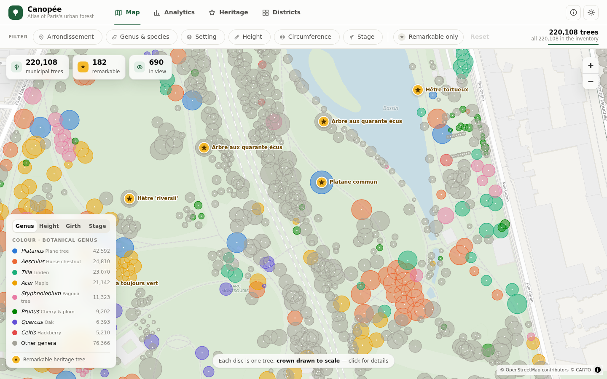
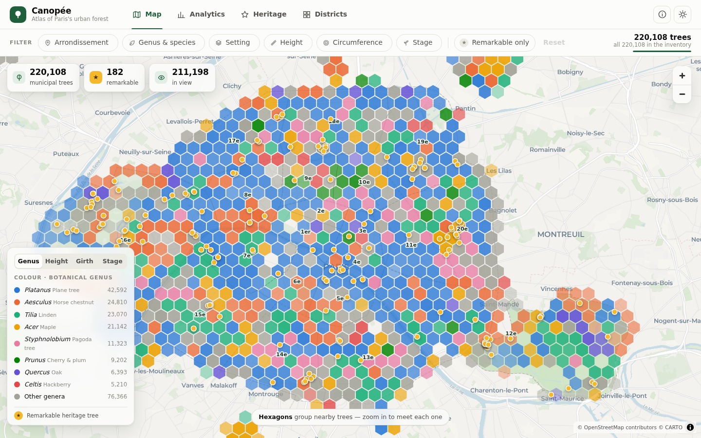
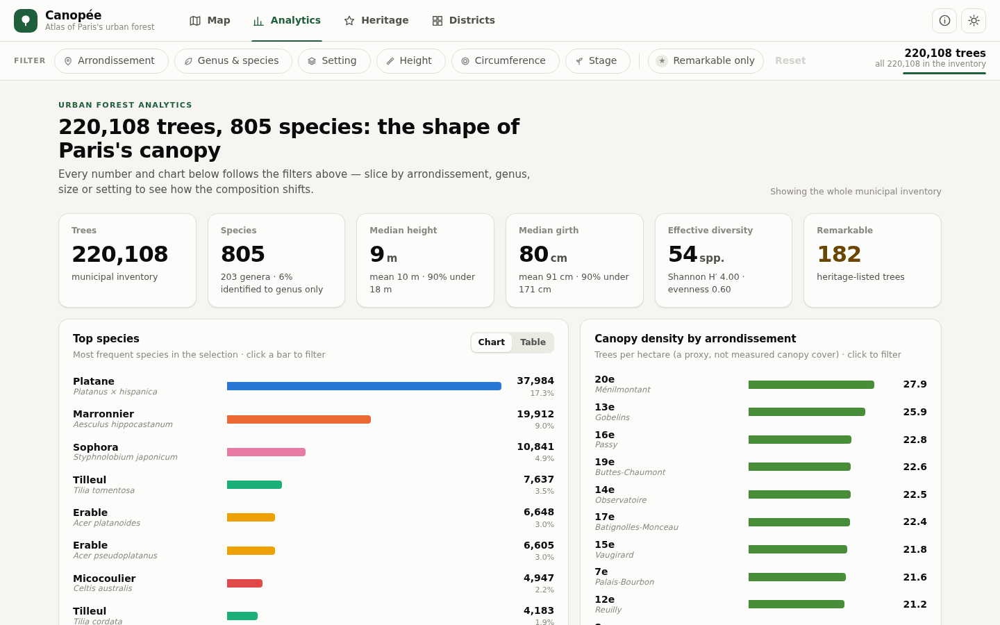
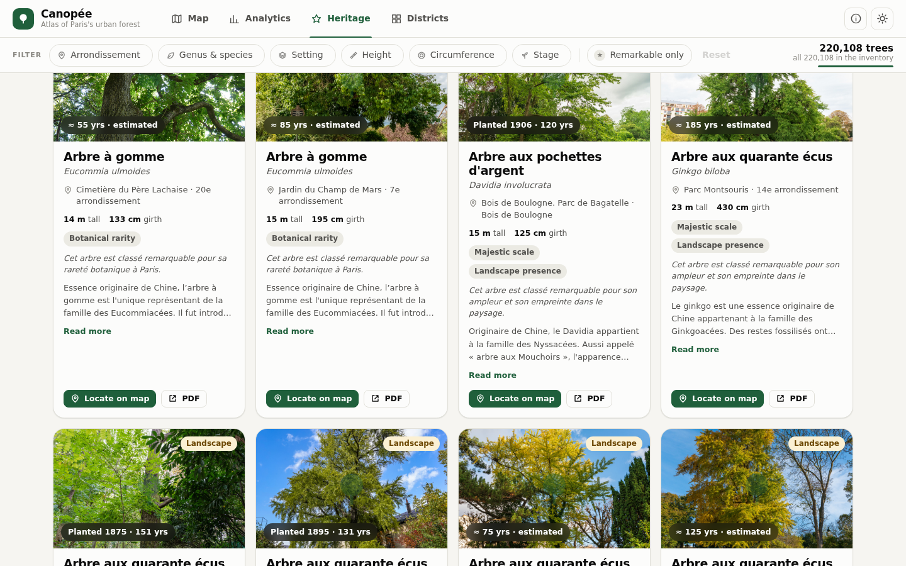
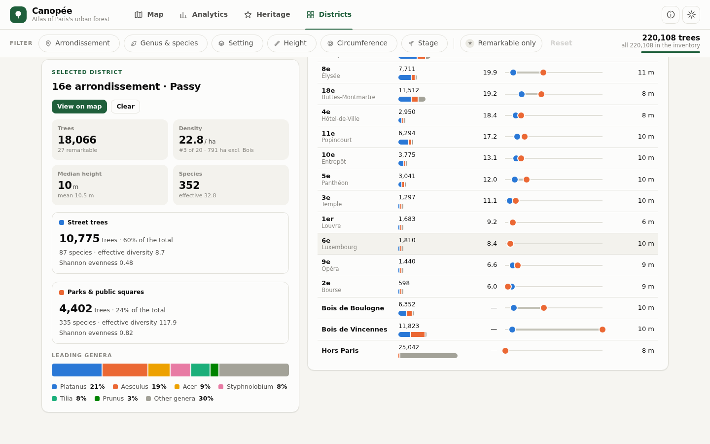
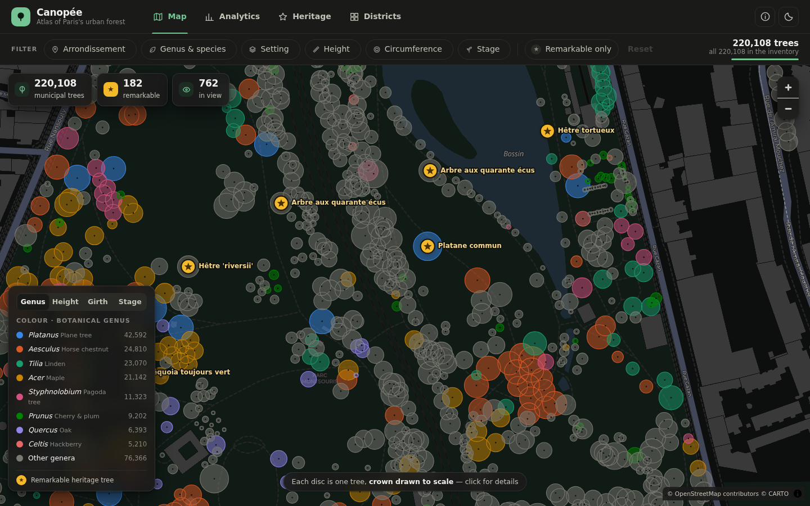

# Canopée — an atlas of Paris's urban forest

An interactive map and biodiversity explorer of the **220,108 municipal trees of Paris**, its **182 remarkable
(heritage) trees** and its 20 arrondissements. Static site, no build step, no API key.

| | |
|---|---|
|  |  |
|  |  |
|  |  |

## Run it

```bash
python3 -m http.server 8000      # any static server works
# open http://localhost:8000
```

The browser needs network access for the basemap tiles (CARTO / OpenStreetMap) and the heritage photos
(`capgeo.sig.paris.fr`). Without tiles the map falls back to a plain background and everything else still works.

## What's in it

**Map** — MapLibre basemap + a custom canvas layer built for 220k points.
* Zoomed out, trees are aggregated into **hexagonal bins** (cached per zoom level; colour = dominant genus or mean value,
  opacity = density). Hover for composition, click to zoom in.
* From ~z14.5 they **crossfade into individual trees drawn as crowns to scale** (radius from recorded height) so you
  can read canopy, gaps and mixed plantings street by street.
* Colour by **genus**, **height**, **girth** or **development stage** — the legend doubles as a genus filter.
* **Remarkable trees** wear gold star badges at every zoom, named when you zoom in.
* Click any tree → detail card: French common name, genus / species / cultivar, height, circumference
  (+ trunk diameter), stage, address, exact coordinates, how it compares with the other trees of its species,
  and — for heritage trees — photo, official citation, criteria, planting year/age, story and PDF fact sheet.

**Filters** (one row, scoping every view): arrondissement 1er–20e (+ the two Bois and "outside Paris"),
genus & species search (try *platane*, *Sophora*, *Tilia cordata*), setting (street / parks & squares / cemeteries /
facilities / périphérique), height range, circumference range, development stage, and a one-click **Remarkable only** toggle.

**Analytics** — trees, species and genera, mean/median height and girth, effective diversity (Shannon), top-species
chart (with table view), genus mix, height & girth distributions, development stage, setting split,
density by arrondissement and a "resilience check" against the 10-20-30 diversity rule of thumb.

**Heritage** — hero stats, a timeline of documented planting years, searchable/sortable cards with photo,
common & Latin name, age, criteria and a **Locate on map** button that flies to the tree.

**Districts** — choropleth with five switchable metrics, a sortable table contrasting **street trees vs parks & squares**
(split bar + species-variety dumbbell), and a street-vs-park diversity panel for any selected arrondissement.

Light and dark themes; responsive down to phones.

## Data

Paris Open Data (Ville de Paris, ODbL / Licence Ouverte): *Les arbres*, *Arbres remarquables*, *Arrondissements*.

```bash
scripts/fetch_data.sh /tmp/paris-raw                    # download the three datasets
python3 -I scripts/build_data.py /tmp/paris-raw data    # -> data/ (committed, ~4 MB)
```

`build_data.py` writes the trees as gzip'd columnar typed arrays (3.4 MB for 220k trees), plus small JSON
dictionaries, the heritage records and the arrondissement polygons.

Cleaning decisions worth knowing:
* 0 means "not recorded" in the source; heights > 60 m and girths > 10 m are treated as entry errors (the source has a
  112 m "tree"). 5 duplicate inventory IDs are dropped.
* The inventory includes ~25k city-owned trees **outside Paris** (parks, cemeteries) and ~18k in the **two Bois**.
  They are separate groups, never mixed into the 20 arrondissements.
* The 12e and 16e outlines include the Bois de Vincennes / Boulogne, whose trees are listed apart — so their density
  is computed over the area **without** the Bois (995 ha / 846 ha). Without this, those two districts would look
  half as dense as they are.
* "Density" is trees per hectare — a proxy, not measured canopy cover.
* `1700-01-01` is the heritage dataset's placeholder for an unknown planting date (105 of 183). For those, the age shown
  is a **rough estimate from girth**, calibrated on the heritage trees with a known year, and always labelled as such.
* One heritage tree appears twice (a single-tree record and an "ensemble" record); the single-tree one is kept.
* The dataset has no botanical family, so colour-coding is by genus. *Sophora japonica* is filed under
  *Styphnolobium*; searching "sophora" finds it.

## Design notes

* **Colour.** Genus uses the eight-slot categorical palette validated with the dataviz skill's `validate_palette.js`
  (adjacent-pair CVD ΔE ≥ 8.4, normal-vision ≥ 19, in both light and dark), assigned in fixed order to
  Platanus, Aesculus, Tilia, Acer, Styphnolobium, Prunus, Quercus, Celtis; every other genus is neutral grey and a colour
  follows its genus, never its rank. On a map any two hues can touch (the validator's all-pairs check is stricter than the
  palette guarantees), so identity is never colour-only: legend, hover names, the detail card and filters all spell it out.
  Height / girth / stage use one-hue OKLCH ramps whose anchor flips in dark mode; gold is reserved for heritage.
* **Performance.** Filtering is one pass over typed arrays (8–20 ms for 220k trees); hex bins are computed once per zoom
  level and filter state; individual trees come from a uniform spatial grid; a frame costs 1–5 ms.
* **Security.** All dataset text goes through `textContent`; only `http(s)` URLs from the data are ever used as `href`/`src`.

## Quality checks

`scripts/qa/` has the Playwright harnesses used while building (visual shots of every view/theme/mobile,
a behavioural run that checks filter counts against the raw CSV, and frame-time / picking checks):

```bash
NODE_PATH=$(npm root -g) node scripts/qa/shots.cjs http://localhost:8000 /tmp/shots
node scripts/qa/interact.cjs http://localhost:8000 /tmp/shots
node scripts/qa/perf.cjs http://localhost:8000 /tmp/shots
```

## Layout

```
index.html  css/style.css  vendor/maplibre-gl.*  data/
js/  main (wiring) · data (load + spatial grid) · state (filters) · stats · map (canvas layer)
     filters-ui · detail · analytics · heritage · districts · charts · theme · icons · format
scripts/  fetch_data.sh · build_data.py · qa/
```

Basemap © CARTO, © OpenStreetMap contributors · MapLibre GL JS (BSD-3).
